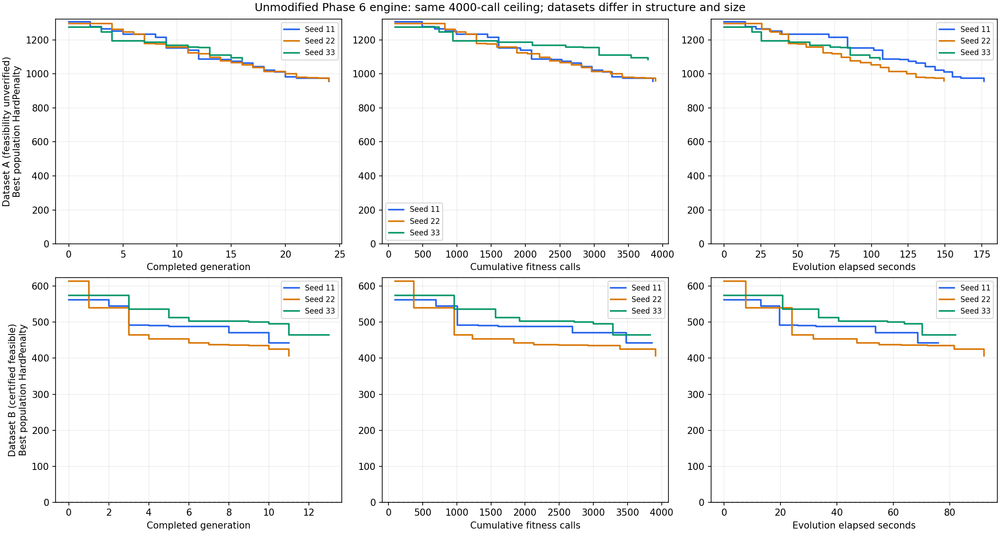

# مقایسهٔ کنترل‌شدهٔ Dataset A و B

این آزمایش فقط ورودی داده را عوض می‌کند؛ Evolution، Initialization، Mutation، Repair و Hard/Soft تغییر داده نشده‌اند. موتور مرجع، sourceهای commit `d2a27231323eb10cdff00e72334fd3a4f5e72f10` است. مشخصات Generator و دستور بازتولید در [CONTROLLED_DATASET_GENERATOR.md](CONTROLLED_DATASET_GENERATOR.md) آمده است.

## نسخه و کنترل آزمایش

در حین این کار، یک ویرایش مستقل در فایل کاری initialization.py دیده شد که metadata زمان پیش‌پردازش را حذف می‌کرد. آن ویرایش دست‌نخورده و خارج از commit این مرحله نگه داشته شد. برای جلوگیری از آمیختن نسخه‌ها، مقایسهٔ نهایی از snapshot فقط‌خواندنی sourceهای commit مرجع در outputs اجرا شد؛ نه از فایل کاری ویرایش‌شده. hash ماژول‌های موتور در JSON ثبت شد. سه اجرای مقدماتی A روی فایل کاری، از جدول‌ها و نمودارهای نهایی کنار گذاشته شدند. نتایج ژنوتیپی آنها با نسخه مرجع همسان بود، ولی زمان آنها به‌عنوان اندازه‌گیری نهایی استفاده نشد.

تنظیمات تمام شش اجرای نهایی: PopulationSize=100، TournamentSize=3، EliteCount=2، MutationProbability=0.30، CrossoverProbability=0.70، RepairEnabled=true، MaxFitnessEvaluations=4000، MaxGenerations=500، StopOnFirstFeasible=false و stagnation=None. Seedها برای هر دو داده 11/22/33 هستند. سقف ۵۰۰ نسل فقط برای یکسان‌بودن تنظیمات و غیربازدارنده‌بودن آن است؛ سقف Fitness عامل توقف آزمایش است. Repair همان ۵ کاندیدا/تعارض، ۵۰ کاندیدا/فراخوانی و ۱۰۰ پیشنهاد را دارد. محدودیت رزرو Mutation ممکن است یک فراخوانی استفاده‌نشده باقی بگذارد؛ ۳۹۹۹ نقض سقف ۴۰۰۰ نیست.

اجراها به‌صورت متوالی انجام شدند. ابزار مشاهده فقط نتیجهٔ ارزیاب واقعی را بدون تغییر برمی‌گرداند و اولین Hard=0، شماره فراخوانی و زمان شامل Initialization را ثبت می‌کند. هزینهٔ بررسی گواهی در هزینه GA حساب نشده است. زمان‌ها به وضعیت ماشین و فعالیت‌های همراه، از جمله ساخت/آزمون گزارش‌ها، حساس‌اند؛ این اندازه‌گیری‌ها benchmark ایزولهٔ سرعت نیستند.

## مشخصات داده‌ها

| مشخصه | A: فایل قبلی | B: دادهٔ سازنده |
|---|---:|---:|
| ردیف دانشکده‌ها در ورودی | 4 | 1 |
| ردیف رشته‌ها در ورودی | 16 | 4 |
| دانشجو | 200 | 200 |
| استاد | 32 | 16 |
| درس | 120 | 32 |
| اتاق | 20 | 6 |
| اتاق نظری | 15 | 4 |
| آزمایشگاه/کارگاه | 5، انواع تخصصی متفاوت | 2، نوع Lab مشترک |
| بازه ۹۰دقیقه‌ای | 25 | 25 |
| درخواست | 1695 | 1600 |
| تاریخچه PassedCourses | 2073 | 0، عمداً خالی |
| رابطه ProfessorCourses، شامل CanTeach=False | 149 | 512 |
| جایگاه بالقوهٔ گروه | 161 | 192 |
| حداقل واحد دانشجو | 8 تا 12 | 15 |
| حداکثر واحد دانشجو | 15 تا 20 | 20 |
| مجموع واحد درخواست‌شده هر دانشجو | 14 تا 28 | 18 |
| دانشجوی دارای درخواست بیش از سقف واحد | 151 | 0 |
| ردیف ProfessorAvailability | 313 | 64 |
| ردیف StudentAvailability | 1199 | 800 |

تعداد ردیف‌های مرجع A به معنی تأیید دامنهٔ دانشگاهی موتور نیست. A همان دادهٔ ناقص/تصادفی قبلی و دست‌نخورده است. B یک نمونهٔ مصنوعیِ یک دانشکده با ۴ رشته و ۵۰ دانشجو برای هر رشته است. تفاوت‌ها فقط یک عامل نیستند: تعداد درس، جلسه، ظرفیت، صلاحیت، واحد و محدودیت زمانی هم فرق دارند. بنابراین Hard خام A/B آزمون تک‌متغیره یا رتبه‌بندی ذاتی دشواری دو مسئله نیست. هدف اصلی، بررسی موفقیت الگوریتم در داده‌ای است که حل‌پذیری‌اش اثبات اجرایی دارد.

SHA256 A:

`e5fc5786323ef43c8bb5c4ea0d5beea1e555a86b1b566da42f070e269526f664`

SHA256 B تحویلی:

`6b90c1c6784cbb81527dfc196e1a5e4347cd56ff988f6ce703a1452093576391`

## گواهی اجرایی B

فایل `data/Dataset_B_Constructive_seed20261103_certificate.json` جدا از Workbook نگهداری می‌شود. برنامهٔ مرجع ابتدا ساخته شده و ورودی‌ها طوری از آن مشتق شده‌اند که هیچ درخواست یا Unavailable برنامه را نامعتبر نکند. پس از تولید XLSX، همان داده با Loader موجود دوباره بارگذاری شد؛ ردیف‌ها با دادهٔ در حافظه برابر بودند و همان ژنوتیپ با Hard Evaluator موجود ارزیابی شد.

- validate_structure قبل و بعد از roundtrip بدون خطا.
- HardPenalty قبل و بعد از roundtrip دقیقاً ۰؛ همهٔ شمارنده‌ها صفر و Violations خالی.
- ۱۴ شیت مطابق schema و صفر هشدار Loader در حالت diagnostics.
- ۶۴ گروه فعال ۲۵نفره؛ تمام ۱۶۰۰ درخواست تأمین‌شده؛ ۱۸ واحد برای هر دانشجو.
- ۹ ساعت تدریس برای هر استاد، در محدوده ۶ تا ۱۲ ساعت؛ استاد/اتاق ثابت در جلسات هر گروه.
- هر درس ۶ استاد واجد صلاحیت و دو گروه فعال دارد؛ اتاق‌ها و صلاحیت‌ها بین رشته‌ها مشترک‌اند.

گواهی به Initializer، GA یا Snapshotهای اجرا داده نشده است. Workbook هیچ Sheet/ستون SectionID، Enrollment یا Witness ندارد. تست Guard خواندن certificate را در اجرای GA ممنوع می‌کند و جمعیت اولیه را با خروجی عادی Initializer مقایسه می‌کند. وجود یک جواب معتبر در فایل گواهی، موفقیت الگوریتم در پیدا کردن آن محسوب نمی‌شود. حل‌پذیری A در این مرحله اثبات یا رد نشده است.

## نتایج شش اجرای نهایی

| داده | Seed | Hard اولیه | بهترین Hard دیده‌شده | Soft همان جواب | Fitness مصرف‌شده | نسل کامل | زمان Evolution، ثانیه | ژنوتیپ یکتای نسل آخر |
|---|---:|---:|---:|---:|---:|---:|---:|---:|
| A | 11 | 1305 | 957 | 0.657088 | 4000 | 24 | 181.90 | 90 |
| A | 22 | 1296 | 960 | 0.654573 | 3999 | 24 | 153.71 | 95 |
| A | 33 | 1275 | 1066 | 0.656006 | 4000 | 16 | 111.97 | 95 |
| B | 11 | 562 | 442 | 0.645262 | 3999 | 11 | 78.55 | 97 |
| B | 22 | 614 | 401 | 0.648697 | 4000 | 11 | 94.02 | 100 |
| B | 33 | 575 | 465 | 0.668039 | 4000 | 13 | 85.59 | 96 |

تمام اجراها با fitness_budget متوقف شدند و نسل ناقص جداگانه ثبت شد. زمان Initialization به‌ترتیب A: ۲٫۱۰/۲٫۱۳/۲٫۱۲ و B: ۱٫۸۷/۲٫۲۴/۲٫۱۲ ثانیه بود. زمان Evolution شامل Initialization نیست. هر مقدار Fitness در جدول دقیقاً همین تعداد Hard و Soft کامل دارد. جمع مصرف شش اجرا ۲۳۹۹۸ Fitness است؛ اندازه آخرین جمعیت کامل در همه آنها دقیقاً ۱۰۰ ماند.

**نرخ یافتن جواب معتبر: A برابر ۰/۳ و B برابر ۰/۳.** در هیچ فراخوانی Fitness، حتی کاندیدای Repair یا مرحلهٔ پیش از Mutation، Hard=0 مشاهده نشد. بنابراین «تعداد ارزیابی و زمان تا اولین جواب معتبر» برای هر شش اجرا **null / نرسیده در بودجه** است؛ زمان ساخت گواهی جای آن گزارش نمی‌شود.

**Dataset B حل‌پذیر بوده، ولی الگوریتم فعلی در هر سه Seed و بودجهٔ آزمایشی موفق به یافتن جواب معتبر نشده است.** این شکست را نمی‌توان صرفاً به ناممکن‌بودن B نسبت داد. در مقابل، حل‌پذیری A همچنان بررسی‌نشده است. این آزمایش به‌تنهایی مشخص نمی‌کند کدام تغییر معماری یا کدام پارامتر بهترین درمان است.

میانگین بهترین Hard در A از ۱۲۹۲ به ۹۹۴٫۳۳ و در B از ۵۸۳٫۶۷ به ۴۳۶ رسید. میانگین زمان Evolution برای A حدود ۱۴۹٫۱۹ و B حدود ۸۶٫۰۵ ثانیه بود؛ هزینهٔ یک Fitness به اندازه و محتوای Dataset/ژنوتیپ وابسته است و زمان‌ها نیز تحت تأثیر بار ماشین‌اند. کوتاه‌تر بودن زمان B اثبات مقیاس‌پذیری یا آسان‌تر بودن همهٔ نمونه‌های مشابه نیست.

## پوشش درخواست‌ها و نوع نقض‌ها

| داده | Seed | درخواست تأمین‌شده / کل | پوشش وزن‌دار Priority |
|---|---:|---:|---:|
| A | 11 | 1570 / 1695 | 96.0278% |
| A | 22 | 1570 / 1695 | 95.9850% |
| A | 33 | 1571 / 1695 | 96.0385% |
| B | 11 | 1599 / 1600 | 99.9657% |
| B | 22 | 1600 / 1600 | 100% |
| B | 33 | 1600 / 1600 | 100% |

پوشش کامل درخواست به معنی برنامهٔ بدون تداخل نیست. گواهی B هم پوشش ۱۰۰٪ دارد، اما برخلاف جواب‌های GA هیچ نقض سختی ندارد. اعداد جدول پایین شدت جریمه‌اند، نه الزاماً تعداد افراد یا رخدادها؛ برای مثال مازاد واحد بر حسب واحد و اضافه‌بار استاد بر حسب نیم‌ساعت جمع می‌شود.

| نوع جریمهٔ بهترین جواب | A/11 | A/22 | A/33 | B/11 | B/22 | B/33 |
|---|---:|---:|---:|---:|---:|---:|
| تداخل استاد | 7 | 6 | 14 | 7 | 6 | 7 |
| تداخل اتاق | 12 | 20 | 21 | 22 | 23 | 31 |
| تداخل دانشجو | 197 | 196 | 285 | 231 | 145 | 266 |
| زمان غیرمجاز شخصی استاد | 26 | 37 | 29 | 10 | 10 | 8 |
| زمان غیرمجاز شخصی دانشجو | 207 | 192 | 203 | 157 | 202 | 150 |
| مازاد واحد دانشجو | 508 | 509 | 514 | 0 | 0 | 0 |
| اضافه‌بار تدریس استاد | 0 | 0 | 0 | 15 | 15 | 3 |
| سایر شمارنده‌های Hard | 0 | 0 | 0 | 0 | 0 | 0 |
| مجموع | 957 | 960 | 1066 | 442 | 401 | 465 |

در B، حذف تناقضِ درخواست بیش از سقف واحد، مازاد واحد را صفر کرده است؛ بااین‌حال تداخل و زمان غیرمجاز دانشجویان همچنان بخش اصلی شکست‌اند. تعداد گروه‌های فعالِ بهترین جواب B در هر سه Seed دقیقاً ۶۴ است، همان تعداد گواهی؛ بنابراین کم یا زیاد بودن تعداد گروه به‌تنهایی توضیح این شکست نیست. این نشانه‌ای برای بررسی آیندهٔ هماهنگی برنامه گروه‌ها و تخصیص دانشجو است، نه اثبات علت یگانه یا مجوز تغییر عملگرها در این مرحله.

## هزینه Repair، تنوع و روند

جمعیت اولیه در هر شش اجرا ۱۰۰ ژنوتیپ یکتا داشت. تعداد یکتای نسل آخر در جدول نتایج آمده و روند کامل در JSON ثبت است؛ تنوع ژنوتیپی بالا در این نمونه‌ها به‌تنهایی رسیدن به جواب معتبر را تضمین نکرد. کاندیداهای Repair در A به‌ترتیب ۷۳۰/۷۳۵/۱۷۶۳ و در B برابر ۲۴۵۷/۲۴۶۱/۲۲۰۰ بودند. در نتیجه B در بودجه یکسان تعداد نسل کمتری طی کرد؛ مقایسهٔ صرفِ تعداد نسل گمراه‌کننده است.

نمودار بهترین عضوِ آخرین جمعیت کامل در هر نسل را نشان می‌دهد. جدول اصلی BestOverall را گزارش می‌کند که مراحل میانی/نسل ناقص را هم دیده است. برای A/33 بهترین جمعیت نهایی Hard=1085 و BestOverall=1066، و برای B/22 به‌ترتیب 407 و 401 است؛ سایر موارد برابرند. این تفاوت مطابق قرارداد Runner است و هیچ جواب بهتر یا گواهی به جمعیت تزریق نشده است. خط صفر در ردیف B هدفی است که امکان وجودش با گواهی مستقل اثبات شده است.

هر شش گزارش از نظر hash موتور، سقف بودجه، جمع هزینهٔ نسل کامل/ناقص، اندازه جمعیت و عدم افت بهترین عضو نسل‌ها بررسی شدند. دوازده برنامهٔ ذخیره‌شده (BestOverall و FinalPopulationBest هر اجرا) بازیابی و ارزیابی مجدد شدند؛ Hard/Soft با گزارش برابر بود. این ۱۲ ارزیابی و بازبینی مستقل گواهی B، خارج از هزینهٔ GA هستند. اعداد و روندهای قابل بازبینی در [PHASE6_DATASET_COMPARISON_RESULTS.json](PHASE6_DATASET_COMPARISON_RESULTS.json) ثبت شده‌اند و نمودار را می‌توان از همان فایل، بدون اجرای دوباره GA، بازساخت.

## حدود نتیجه‌گیری

- نتیجهٔ قطعی فقط این است: موتور فعلی در این سه Seed و سقف ۴۰۰۰ فراخوانی، Bِ حل‌پذیر را حل نکرد. نتیجه، اثبات ناتوانی در همهٔ بودجه‌ها/Seedها یا وجود باگ مشخص در ارزیاب نیست.
- تنها یک Dataset سازنده با Seed تولید 20261103 و سه Seed جست‌وجو بررسی شده؛ آزمون خانواده Generator، آزمایش آماری GA روی همهٔ آن خانواده محسوب نمی‌شود.
- B ساده‌سازی کنترل‌شدهٔ یک دانشکده است؛ انواع آزمایشگاه، تعداد منابع، درخواست‌ها و قواعد واحد با A فرق دارند. از اختلاف Hard خام، نسبت سرعت یا پوشش نمی‌توان اثر مستقل هر تغییر را استخراج کرد.
- گواهی Hard=0 تضمین بهینگی Soft نیست. خود Generator و اطلاعات جواب معتبر به الگوریتم داده نشده‌اند.
- هیچ تغییری برای کاهش مصنوعی جریمه، افزودن Repair تازه یا افزایش بودجه انجام نشد. تصمیم‌های اصلاح Initialization/Repair/هدف‌گیری، مرحلهٔ معماری بعدی هستند.

## آزمون‌ها و بازتولید

۲۵۰ آزمون روی موتور مرجع و کد جدید موفق شدند: ۲۲۸ آزمون قبلی و ۲۲ آزمون جدید. آزمون‌های جدید، تکرارپذیری Seed، تغییر با Seed دیگر، شش Seed سازندهٔ اضافی، ساختار/ظرفیت/واحد/ساعت، منابع مشترک، Unavailable ایمن، schema بدون ژن جواب، دو export و بارگذاری مجدد، گواهی ذخیره‌شده، عدم انتشار نمونه خراب، حفظ فایل موجود/A، عدم نشت گواهی، برابری مشاهده با اجرای عادی و ثبت دقیق اولین جواب معتبر را پوشش می‌دهند. تست hash source مرجع نیز وجود دارد.

فرمان `python scripts/test_controlled_baseline.py` بدون تغییر فایل کاری کاربر، همه آزمون‌ها را روی موتور مرجع و ماژول آزمایشی جدید اجرا می‌کند. فقط آزمون بازتولید XLSX به runtime اختیاری artifact-tool نیاز دارد؛ در محیط این اجرا در دسترس بود و هیچ آزمونی skip نشد. دستور مقایسه: `python scripts/run_pinned_dataset_comparison.py --output outputs/DATASET_COMPARISON_PINNED.json`.

فایل A بازنویسی نشده است. فایل B و certificate نام‌های مستقل در data دارند؛ خروجی‌های ریز هر Seed و بهترین برنامه‌های قابل بازیابی در outputs نگهداری می‌شوند. Commit این مرحله هیچ‌یک از ماژول‌های موتور مرجع را تغییر نمی‌دهد.
