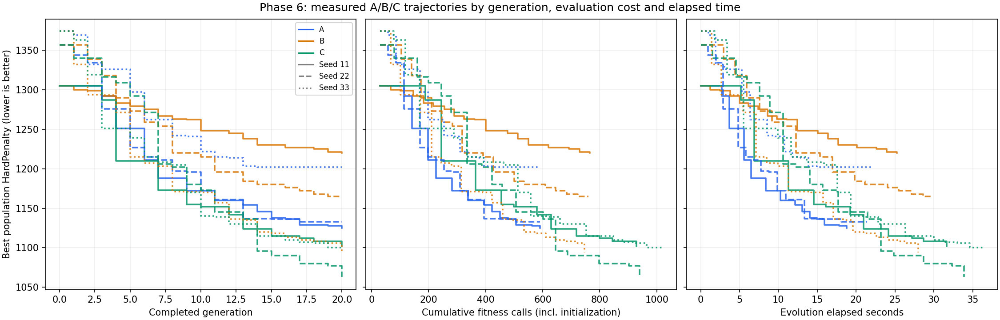

# گزارش Phase 6 — Evolution Loop

تاریخ: ۲۰۲۶-۱۱-۰۳. شاخه: `codex/evolution-loop-phase6`. پایه main شامل Merge تأییدشده PR #5 با SHA `36a4ed0` است. PR و Merge این مرحله طبق دستور با کاربر است.

## تحویل و آزمون

`src/scheduler/evolution.py` حلقه نسل، Elitism، بهترین جواب‌ها، توقف و شمارش هزینه را متصل می‌کند. `evolution_reporting.py` گزارش JSON و ذخیره/بازیابی ژنوتیپ را فراهم می‌کند. CLI در `scripts/run_evolution_experiment.py` و رسم نمودار اختیاری با Matplotlib در `scripts/plot_evolution_experiments.py` است. هیچ کد فازهای قبلی و هیچ Dataset/Policy/فرمول Fitness تغییر نکرده است. قرارداد کامل در [EVOLUTION_LOOP.md](EVOLUTION_LOOP.md) ثبت شده است.

**۲۲۸ آزمون موفق**: تمام ۱۹۹ آزمون قبلی و ۲۹ آزمون جدید. موارد جدید شامل اندازه ثابت جمعیت، Tournament موجود، Clone/Crossover و Mutation صفر/یک، Repair روشن/خاموش، حفظ Elite/والد/cache، رد Snapshot کهنه، خطای ساختاری صریح، Seed و PYTHONHASHSEED، توقف نسل/feasible/رکود/بودجه، حسابرسی واقعی Fitness/Hard/Soft، گزارش نامعتبر، سه بهترین جواب مستقل، Initialization-only، JSON قابل بازیابی، CLI و Dataset واقعی هستند.

آزمون ضد Greedy با Fitness واقعی، والد Hard=0 و فرزند Hard=2 می‌سازد و جمعیت نسل بعد `[0,2,2]` است: دو فرزند بدتر پذیرفته و Elite حفظ می‌شود. آزمون دیگری Mutation بدتر را با Repair بدون کاندیدا به نسل بعد می‌برد و والد جایگزین نمی‌شود. مرز رکود نیز با Hardهای `[0,0,0]` و Softهای `[8/9,1,1]` آزموده شد؛ بهبود Soft مانع توقف زودهنگام می‌شود. فراخوانی‌های واقعی ارزیاب‌ها با spy شمرده و با EvaluationUsage برابر شدند؛ هزینه هیچ Elite دوباره پرداخت نشد.

## داده و تنظیمات آزمایش

همان فایل ناقص و تصادفی یک دانشکده، بدون اصلاح خودکار استفاده شد. SHA256 مبنا و پایان:

`e5fc5786323ef43c8bb5c4ea0d5beea1e555a86b1b566da42f070e269526f664`

ماتریس: جمعیت ۳۰، ۲۰ نسل، Tournament=3، Elite=2، Crossover=0.70، StopOnFirstFeasible=false، بدون رکود، سقف کل ۴۰۰۰ Fitness، Seedهای ۱۱/۲۲/۳۳. Repair پیش‌فرض ۵ کاندیدا/تعارض، ۵۰ کاندیدا/فراخوانی و ۱۰۰ پیشنهاد دارد. A: Mutation=0 و Repair خاموش؛ B: Mutation=0.30 و Repair خاموش؛ C: Mutation=0.30 و Repair روشن. بقیه Settings یکسان‌اند؛ جمعیت اولیه هر Seed بین سه حالت یکسان است. مسیر تصادفی بعد از شروع عملگرها یکسان باقی نمی‌ماند؛ این آزمایش، زوج‌سازی تک‌تک رویدادهای تصادفی نیست.

اجرای اول مستقل مطابق درخواست با جمعیت ۳۰ و ۲۰ نسل، Seed=11 و حالت C انجام شد: Hard از ۱۳۰۵ به ۱۱۰۲ رسید؛ ۹۲۹ Fitness (۱۸۶ کاندیدای Repair) و ۲۹٫۹۸ ثانیه Evolution مصرف شد. سپس ماتریس کامل اجرا شد؛ تکرار C/11 همان ژنوتیپ/نمره/شمارش را با زمان متفاوت داد. Context برای ماتریس یک بار ساخته و بین اجراها بازاستفاده شد؛ زمان‌ها اندازه‌گیری محلی و غیراستانداردشده‌اند.

## ماتریس واقعی

| حالت | Seed | Hard اولیه | بهترین Hard دیده‌شده | Soft همان جواب | Fitness کل | کاندیدای Repair | زمان Evolution، ثانیه |
|---|---:|---:|---:|---:|---:|---:|---:|
| A | 11 | 1305 | 1125 | 0.666068 | 590 | 0 | 18.79 |
| B | 11 | 1305 | 1220 | 0.655352 | 765 | 0 | 25.24 |
| C | 11 | 1305 | 1102 | 0.652779 | 929 | 186 | 31.66 |
| A | 22 | 1357 | 1133 | 0.662278 | 590 | 0 | 21.41 |
| B | 22 | 1357 | 1165 | 0.662664 | 760 | 0 | 29.90 |
| C | 22 | 1357 | 1063 | 0.661144 | 940 | 192 | 33.87 |
| A | 33 | 1374 | 1202 | 0.659715 | 590 | 0 | 21.91 |
| B | 33 | 1374 | 1094 | 0.642336 | 747 | 0 | 28.02 |
| C | 33 | 1374 | 1100 | 0.661389 | 1020 | 270 | 36.35 |

تمام اجراها ۲۰ نسل کامل و توقف max_generations داشتند؛ سقف ۴۰۰۰ پر نشد. **هیچ جواب Hard=0 پیدا نشد.** Soft بالاتر نمی‌تواند Hard بیشتر را جبران کند. در Seed=33، B نسبت به C هم Hard کمتر و هم هزینه کمتری در همین اجرای محدود داشت؛ C در همه Seedها برنده نیست.

برای مقایسه منصفانه‌تر، از آمار ذخیره‌شدهٔ آخرین نسل کامل زیر سقف مشترک ۵۹۰ Fitness و زیر ۱۵ ثانیه Evolution نیز استفاده شد. هزینه اولیه در سقف Fitness شامل است؛ محور زمان فقط Evolution است. این‌ها نقاط ثبت‌شده با هزینه حداکثر سقف‌اند، نه درون‌یابی یا اجرای تازه دقیقاً با هزینه مساوی. تعداد نسل و بودجه استفاده‌نشده متفاوت است.

| حالت | میانگین Hard پایان ۲۰ نسل | میانگین Fitness پایان | میانگین زمان، ثانیه | میانگین Hard زیر سقف ۵۹۰ Fitness | میانگین Hard زیر سقف ۱۵ ثانیه |
|---|---:|---:|---:|---:|---:|
| A | 1153.33 | 590.00 | 20.71 | 1153.33 | 1158.33 |
| B | 1159.67 | 757.33 | 27.72 | 1176.00 | 1212.67 |
| C | 1088.33 | 963.00 | 33.96 | 1142.33 | 1181.00 |

در سقف ۵۹۰، A نسل ۲۰ و دقیقاً ۵۹۰ فراخوانی؛ B نسل ۱۵ با ۵۸۵/۵۶۹/۵۷۲؛ C نسل ۱۲/۱۲/۱۰ با ۵۸۰/۵۵۵/۵۵۸ فراخوانی دارد. در سقف ۱۵ ثانیه، نسل‌های A برابر ۱۶/۱۴/۱۴، B برابر ۱۱/۹/۱۰ و C برابر ۹/۹/۷ هستند. میانگین C در ۲۰ نسل پایین‌تر است ولی در سقف زمان، A بهتر است. فقط سه Seed و یک Dataset آزمایشی برای حکم برتری عمومی یا مقیاس دانشگاه کافی نیستند.

نمودار بهترین عضو جمعیتِ هر نسل کامل را نشان می‌دهد؛ سه رنگ حالت و سه نوع خط Seed را مشخص می‌کنند. در برخی اجراها BestOverall که شامل مراحل میانی هم هست، اندکی بهتر از آخرین جمعیت است؛ این تفاوت در JSON تفکیک شده است.

در هر اجرای ماتریس ۵۶۰ فرزند وارد نسل‌ها شدند. فرزندان بدتر از هر دو والد برای A به‌ترتیب ۱۴۷/۱۲۳/۱۴۷، برای B برابر ۱۳۸/۱۴۸/۱۷۹ و برای C برابر ۱۶۶/۱۵۵/۱۷۴ بودند؛ این رفتارِ اکتشاف حفظ شده است. تعداد ژنوتیپ یکتای نسل آخر در A برابر ۴/۲/۴، در B برابر ۲۷/۲۷/۲۳ و در C برابر ۲۱/۲۵/۲۹ بود. کاهش تنوع A مشاهده واقعی است، نه دلیل افزودن Adaptive Mutation در این فاز.

## اجرای بزرگ‌تر و حسابرسی خروجی

جمعیت ۱۰۰، حداکثر ۳۰ نسل، Seed=11، حالت C و سقف سخت ۴۰۰۰ Fitness: **۲۴ نسل کامل** ساخته شد و توقف `fitness_budget` در نسل ۲۵ رخ داد. در آن تلاش ۹۵ فرزند از ۹۸ فرزند لازم تکمیل شدند؛ آن نسل جایگزین جمعیت نهایی نشد و هزینه‌اش در partial_generation باقی ماند. جمعیت نهایی دقیقاً ۱۰۰ عضو و بهترین Hard آن و BestOverall هر دو **۹۵۷** (از ۱۳۰۵ اولیه)، با Soft=0.657088 و پوشش وزن‌دار درخواست≈0.960278 بود. BestFeasible=None؛ این جواب معتبر نیست.

هزینه دقیق: Initialization=100، baseline فرزند=2447، پس از Mutation=723، کاندیدای Repair=730؛ جمع **۴۰۰۰ Fitness = ۴۰۰۰ Hard = ۴۰۰۰ Soft**. هزینه دو baseline اضافی Mutation/Repair صفر بود. Context≈0.0128، Initialization≈1.878 و Evolution≈134.13 ثانیه بود. هزینه نسل ناقص ۱۴۴ فراخوانی (۹۵+۲۹+۲۰) است و از جمع کل حذف نشده است.

تفکیک Hard بهترین جواب: مازاد واحد دانشجویان ۵۰۸، زمان غیرمجاز شخصی دانشجو ۲۰۷، تداخل دانشجو ۱۹۷، زمان غیرمجاز شخصی استاد ۲۶، تداخل اتاق ۱۲ و تداخل استاد ۷؛ مجموع ۹۵۷. نقض نوع اتاق، صلاحیت استاد، حداقل/ظرفیت گروه و سقف تدریس در این جواب صفر است. این توزیع پیشنهاد می‌کند معمار در مرحله بعد درباره حرکت‌های هدفمند اصلاح واحد و تعارض دانشجو تصمیم بگیرد؛ در این فاز ارزیاب یا عملگر تازه‌ای برای پنهان‌کردن هزینه اضافه نشد.

هر ۱۰ گزارش ماتریس/بزرگ از نظر اندازه جمعیت، جمع هزینه نسل‌ها به‌علاوه نسل ناقص و عدم افت بهترین Fitness نسل‌های کامل حسابرسی شدند. **۲۰ کروموزوم ذخیره‌شده** (BestOverall و FinalPopulationBest هر گزارش) از JSON بازیابی و با Fitness کامل دوباره ارزیابی شدند؛ Hard/Soft دقیقاً با گزارش برابر بود. این ۲۰ ارزیابی، اعتبارسنجی بیرون از GA است و در بودجه benchmark مخلوط نشده است. [PHASE6_EXPERIMENTS.json](PHASE6_EXPERIMENTS.json) Settings، زمان، تفکیک هزینه، مؤلفه‌های Hard و روندهای عددی قابل ترسیم را برای بازبینی در Git حفظ می‌کند؛ فایل کامل جلسات/تخصیص‌ها محلی باقی می‌ماند.

## محدودیت‌ها و تصمیم‌های اجرایی

- فرمول یا داده برای رسیدن مصنوعی به Hard=0 تغییر نکرده است. بهترین نامعتبر همراه Violations و مؤلفه‌های Hard/Soft ذخیره شده؛ نبود جواب معتبر اثبات حل‌ناپذیری نیست.
- Evolution برای این داده و این بودجه تست شده است؛ ادعای پشتیبانی دانشگاه بزرگ یا کیفیت نهایی مطرح نمی‌شود.
- تصمیم‌های اجرایی ثبت‌شده: EliteCount مثبت و کمتر از جمعیت، تساوی Elite با index پایدار، توقف‌های عادی در مرز نسل کامل، رزرو امکان ارزیابی Mutation، و نگهداری آخرین جمعیت کامل در قطع بودجه. معمار می‌تواند درباره سیاست نسل ناقص یا توقف فوری میانه نسل تصمیم دیگری ثبت کند.
- منشأ Context در کروموزوم خام همچنان مسئله باز فاز 5B است؛ Runner با یک Context و Snapshotهای متناظر کار می‌کند. Context یا Policy جدید نیازمند اجرای جدید است.
- Conflict Repair موجود روی زمان/استاد/اتاق/انتقال همان درس کار می‌کند؛ انتقال به‌تنهایی تعداد واحد دانشجو را تغییر نمی‌دهد و مثلاً مازاد ۵۰۸ واحد در جواب بزرگ را مستقیماً رفع نمی‌کند. افزودن حرکت یا تغییر وزن/بودجه نیاز به تصمیم و آزمایش بعدی دارد.
- خطای غیرمنتظره، اجرای موفق یا benchmark کامل محسوب نمی‌شود؛ گزارش failure حسابرسی ناقص را صریح مشخص می‌کند. خروجی‌های عادی این آزمایش‌ها هیچ failure نداشتند.

JSONهای کامل و فایل‌های `_solutions.json` در outputs/PHASE6_FIRST، outputs/PHASE6_MATRIX_* و outputs/PHASE6_LARGE ذخیره می‌شوند و طبق قرارداد مخزن وارد Git نمی‌شوند. دستورهای بازتولید، قابلیت بازیابی و مرز حسابرسی در EVOLUTION_LOOP.md آمده است. موتور Resume، Parallel Evolution، UI و Student-Based Crossover ساخته نشده‌اند.
