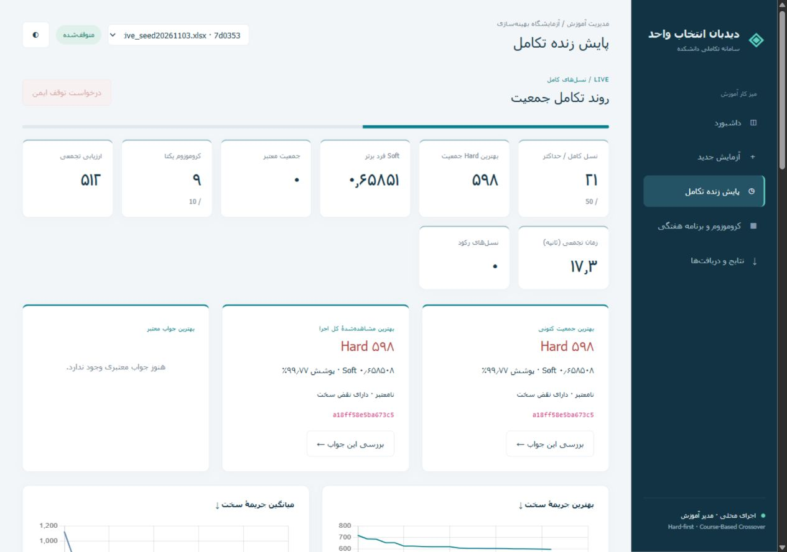
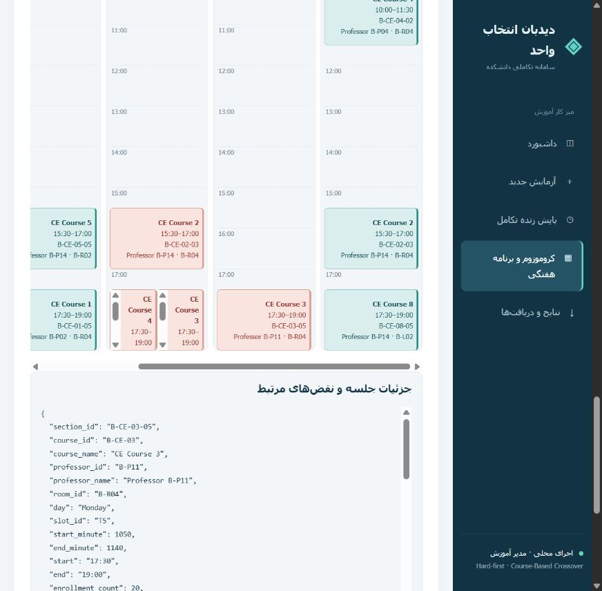

# Phase 7 — گزارش رابط مدیریت آموزش و مانیتور زنده

تاریخ: ۲۰۲۶-۱۱-۰۳. شاخه: `codex/live-monitor-admin-ui`.

مبنا پس از fetch: کامیت `13445dd5da0e942bf0c9a582f1ff9633d7bb7066` شاخهٔ فاز ۶؛ PR شمارهٔ ۶ در زمان بررسی باز بود و main هنوز فاز ۶ را نداشت. PR جدید یا Merge انجام نمی‌شود.

## قابلیت‌های اجراشده

- پنج بخش فارسی RTL: داشبورد، آزمایش جدید، مانیتور، بازرس کروموزوم/تقویم و نتایج؛ حالت روشن/تیره و چیدمان واکنش‌گرا.
- بارگذاری xlsx واقعی، کنترل همان Loader، نمایش errors/warnings/Diagnostics مستقل، آمار واقعی Dataset و انتخاب A/B بدون witness.
- تنظیمات واقعی EvolutionSettings و Repair؛ سقف کلی Fitness اختیاری و پیش‌فرض None.
- یک worker محلی، lifecycle شامل Idle/Running/Stopping/Completed/Stopped/Failed، reconnect پس از refresh و خطای صریح worker.
- callback اختیاری در مرز نسل کامل؛ نسل صفر، شش نمودار و آمار واقعی Elitism/Selection/Crossover/Mutation/Repair/کیفیت فرزند.
- تفکیک CurrentPopulationBest، BestOverall و BestFeasible؛ نتایج نامعتبر با Hard مثبت مشخص می‌شوند.
- جدول مرتب‌شوندهٔ کروموزوم‌ها، snapshot پایدار و نگهداری current + ده جمعیت قبلی به‌صورت پیش‌فرض؛ best هر نسل و آمار همهٔ نسل‌ها حفظ می‌شود. نگهداری صریح جمعیت منتخب روی دیسک ممکن است.
- تقویم هفتگی واقعی دانشجو، استاد و اتاق؛ واحدها، زمان واقعی Slot، چندجلسه‌ای، هم‌پوشانی در laneهای مستقل، جزئیات جلسه و نقض‌های مرتبط.
- تاریخچهٔ پایدار، خروجی JSON و چهار شیت Excel دقیقاً برای snapshot منتخب با هشدار نامعتبر و fingerprint.
- راه‌انداز Windows با ساخت `.venv-ui`، نصب وابستگی‌های مشخص، localhost و بازکردن مرورگر؛ محیط موجود در اجرای بعدی بازاستفاده می‌شود.

## تغییر موتور

فقط `src/scheduler/evolution.py` برای `EvolutionProgress`، ورودی اختیاری `on_generation` و `stop_requested` تغییر کرده است. callback از ژن‌ها کپی جدا دریافت می‌کند. توقف در مرز نسل کامل، بدون kill، اعمال می‌شود. Selection، Crossover، Initialization، Mutation، Repair، Hard/Soft و وزن‌ها تغییر داده نشدند. فرزند بدتر حذف نمی‌شود و هیچ جواب شاهدی وارد الگوریتم نشد.

## تست‌ها

**۲۷۷ آزمون موفق، بدون skip یا failure** روی همهٔ فایل‌های جدید/جاری فاز ۷ با استفاده از Initialization نسخهٔ committed. زمان خود unittest در اجرای نهایی ثبت‌شده حدود ۲۹٫۵ ثانیه بود. ۲۵۰ تست قبلی و **۲۷ تست جدید** اجرا شدند.

تست‌های جدید شامل deterministic equivalence با مانیتور روشن/خاموش، عدم مصرف RNG سراسری، عدم ارزیابی اضافه، جدایی کپی callback، توقف تعاونی، خطای observer، lifecycle، رکود و اولین feasible، منع اجرای هم‌زمان، reconnect، retention/eviction/pin، استقلال snapshot، بازیابی تاریخچه و crash، صحت تقویم و مدت غیر۹۰دقیقه‌ای، چندجلسه‌ای، هم‌پوشانی، واحدها، گروه غیرفعال، فایل نامعتبر، token/host، مسیر دانلود، پاسخ API، RTL، Excel و حفاظت از رشتهٔ شبیه فرمول هستند. integration عادی Dataset B فقط دو نسل با جمعیت ۶ دارد، نه ۵۰۰ نسل.

**وضعیت تغییر قبلی کاربر:** پیش از این فاز `src/scheduler/initialization.py` در working tree تغییر داشت و `preparation_seconds` حذف شده بود. اجرای مستقیم ۲۵۰ تست قبلی روی آن working tree یک AttributeError در `test_statistics_match_manual_recalculation` داشت. آن تغییر نه اصلاح و نه commit شد. برای بررسی نسخه‌ای که ارسال می‌شود، همان فایل از `HEAD:src/scheduler/initialization.py` در یک فایل موقت بارگذاری شد و تمام ۲۷۷ تست با بقیهٔ کد جدید اجرا شدند؛ فایل محلی کاربر دست‌نخورده ماند. تمام ۲۷ تست جدید همچنین مستقلاً روی working tree موفق شدند. این تمایز عمداً پنهان نشده است.

JavaScript با `node --check` موفق بود. مرورگر واقعی به سرور متصل شد؛ خطای console در بررسی نهایی وجود نداشت. عرض‌های ۱۲۸۰ و ۵۲۰ بررسی شدند؛ عرض document از viewport بیشتر نبود و sidebar در موبایل static شد. override آزمایشی viewport پس از تست reset شد. assets محلی Bootstrap/Chart.js با موفقیت بارگذاری شدند. راه‌انداز BAT یک بار محیط ساخت و نصب کرد و در اجرای بعد بدون نصب دوباره سرور را بالا آورد.

## اجرای واقعی از خود رابط

Dataset B hash:

`6b90c1c6784cbb81527dfc196e1a5e4347cd56ff988f6ce703a1452093576391`

| آزمایش UI | جمعیت | نسل کامل | وضعیت / دلیل | Hard اولیه → بهترین | Fitness calls | زمان Initialization + Evolution |
|---|---:|---:|---|---|---:|---:|
| تکمیل کوتاه | 10 | 3 | Completed / max_generations | 718 → 655 | 81 | 2.911 s |
| توقف از دکمهٔ UI | 10 | 21 | Stopped / manual_stop | 718 → 598 | 512 | 17.473 s |

Seed هر دو ۱۱، Tournament=3، Elite=2، Mutation=.30، Crossover=.70، Repair روشن و سقف Fitness=None بود. در آزمایش توقف، MaxGenerations=50 تنظیم شد ولی فقط **۲۱ نسل کامل** اجرا شد؛ این نتیجه اجرای ۵۰نسلی یا آزمایش طولانی همگرایی نیست. این اجراها هیچ جواب Hard=0 پیدا نکردند و در UI نیز نامعتبر نمایش داده شدند. هدف این فاز صحت اتصال UI است، نه اثبات کیفیت GA. زمان‌های مانیتور و خروجی آخر به‌علت سربار callback/نوشتن گزارش می‌توانند اندکی متفاوت باشند.

در مرورگر، دانشجوی B-S001 از snapshot منتخب ۱۸ واحد با محدودهٔ ۱۵ تا ۲۰ داشت؛ کلاس‌های چندجلسه‌ای و تداخل Monday/T5 نمایش داده شدند. استاد منتخب ۷۲۰ دقیقه (۱۲ ساعت) تدریس با سقف ۱۲ ساعت داشت. اتاق منتخب ظرفیت ۳۰ و مشخصات واقعی فضا را نشان داد. بازکردن Inspector، تغییر نقش و دانلود هیچ Fitness جدیدی اجرا نکرد.

## تطبیق مستقل Excel دانلودشده

فایل دریافت‌شده از دکمهٔ واقعی مرورگر: `schedule_a18ff58e5ba6.xlsx`، snapshot نسل ۲۱ با fingerprint:

`a18ff58e5ba673c503a949cb00c37f3f77edfc65ca808fdb642d45a71b0b0af5`

- هر **۹۸ ردیف جلسهٔ گروه‌ها** با SectionGene/Slot/Professor/ظرفیت و تعداد اعضا تطبیق مستقل داده شد.
- هر **۱۶۰۰ درخواست**، از جمله چهار None، در Student Enrollments مطابق EnrollmentGenes بود.
- هر **۲۳۹۶ جلسهٔ دانشجویان** با تخصیص‌ها و جلسات ژن‌ها برابر بود.
- Validation Report شامل نسل ۲۱، همین fingerprint، Hard=598 و هشدار صریح نامعتبر بود.
- فایل با openpyxl دوباره باز و تمام ردیف‌ها با Counterهای مستقل ساخته‌شده از ژن‌ها بررسی شد. نام‌ها و متن‌ها فرمول Excel نیستند.

هش هر دو فایل مبنای A و B بعد از کار همچنان برابر مقدار اولیه بود. [شواهد ماشینی](PHASE7_VERIFICATION.json) شامل نتیجهٔ تست، metadata اجراها، fingerprint و شمار ردیف‌های تطبیق‌شده است.

## فایل‌ها

ایجادشده:

- `src/scheduler_web/{__init__,app,services,projection}.py`
- `src/scheduler_web/templates/index.html`
- `src/scheduler_web/static/{app.js,app.css}` و `vendor` شامل Bootstrap RTL 5.3.3، Chart.js 4.4.8 و مجوزهایشان
- `tests/test_web_ui.py`
- `start_ui.bat`، `scripts/start_ui.py`، `scripts/prepare_ui_environment.py` و `requirements-ui.txt`
- `docs/WEB_UI_ARCHITECTURE.md`، `docs/LIVE_GA_MONITOR.md`، همین گزارش، `PHASE7_VERIFICATION.json` و دو تصویر واقعی UI

به‌روزشده: `src/scheduler/evolution.py`، `.gitignore`، `README.md` و `docs/IMPLEMENTATION_STATUS.md`.

تغییرات قبلی `.run/*.run.xml` و Initialization و دو اسکریپت ناتمام آزمایش long-run حفظ و از commit فاز ۷ کنار گذاشته شدند. داده‌های اجرا، محیط مجازی و uploadهای محلی وارد Git نمی‌شوند.

## محدودیت‌ها و موارد باز

- تک‌مدیر و یک فرایند/worker؛ برای استقرار عمومی یا چند سرور روی storage مشترک نیست.
- توقف تا پایان نسل جاری منتظر می‌ماند؛ مدت آن به داده و بودجهٔ Repair بستگی دارد.
- Resume الگوریتم پس از crash/بستن سرور وجود ندارد؛ آخرین نسل کامل و snapshotها قابل مشاهده‌اند.
- آمار همهٔ نسل‌ها و bestهای روی دیسک با طول اجرا رشد می‌کنند؛ پاک‌سازی تاریخچه یا سقف کل دیسک ساخته نشده است. Full populationهای ذخیره‌شدهٔ صریح هم باید توسط مالک نگهداری شوند.
- فقط xlsx؛ StudentName/RoomName در schema موجود نیست و برایشان ID نمایش داده می‌شود.
- فقط Course-Based Crossover موجود است؛ UI عملیاتی را که موتور ندارد نمایش نمی‌دهد.
- خروجی دارای Hard مثبت تأیید آموزشی نهایی محسوب نمی‌شود. حل‌پذیری Dataset B به معنی رسیدن GA به جواب معتبر نیست.
- بعضی پنل‌های جزئیات تخصصی، رکوردهای دقیق evaluator را به JSON نشان می‌دهند؛ این اطلاعات برچسب‌خورده‌اند و هیچ عددی در frontend جعل نمی‌شود.

## راه‌اندازی

روی `start_ui.bat` دوبار کلیک کنید؛ سپس `http://127.0.0.1:8000`. نصب اولیه اینترنت و Python 3.11+ می‌خواهد؛ PyCharm و Administrator لازم نیست. راهنمای گام‌به‌گام و روش توقف در [LIVE_GA_MONITOR.md](LIVE_GA_MONITOR.md) آمده است.

