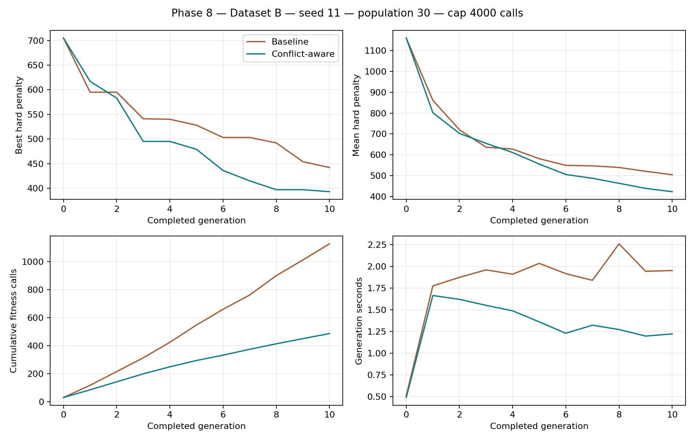

# Phase 8 — Conflict-Aware Repair: گزارش اجرا

شاخه: `codex/conflict-aware-repair`. مبنا: `ed8a3436664b487cee3e0ebef0447507b511a93c`، شامل UI و Seed خودکار؛ PRهای ۶ و ۷ هنگام بررسی باز بودند و main آن کدها را نداشت. PR جدید یا Merge ساخته نشده است.

## تغییر و ضعف مبنا

Repair قدیمی پیشنهادهای عمومی MoveMeeting/ChangeProfessor/ChangeRoom/MoveStudent را با ترتیب shuffle و فیلتر درشت section/course تولید می‌کرد. حتی پیشنهاد نامرتبط تلاش خام مصرف می‌کرد؛ مقصد از نظر اشغال/Availability پیش‌فیلتر نمی‌شد و جلسهٔ واقعاً درگیر مستقیماً هدف قرار نمی‌گرفت. ثبت baseline violations نیز می‌توانست زوجی را دوباره بررسی کند که تغییر قبلی حل کرده بود.

مسیر جدید فقط برای H04_ROOM_OVERLAP فعال است: هر دو endpoint و meeting_index دقیق را می‌گیرد، پیشنهادها را بین دو سمت نوبتی توزیع و پیش از Fitness، بازه‌های واقعی اشغال اتاق/استاد/دانشجو و Unavailableهای Context را بررسی می‌کند. تابع overlap همان helper ارزیاب مرجع است. نوع/ظرفیت اتاق از نگاشت آمادهٔ Context می‌آید. پذیرش همچنان فقط با canonical evaluate_fitness و comparison_key=(HardPenalty,-SoftScore) است. هیچ فرمول یا قید تغییر نکرد.

جزئیات API، ترتیب، بودجه‌ها، cache و قرارداد اتاق در [CONFLICT_AWARE_REPAIR.md](CONFLICT_AWARE_REPAIR.md) آمده است. تمام ردها از والد جدا هستند؛ جایگاه گروه، استاد، Enrollmentها و سایر جلسات زمانی عوض نمی‌شوند. اگر اتاق جایگزین شود، چون RoomID یک ژن سطح گروه است، تمام جلسات همان گروه از نظر اتاق جدید کنترل می‌شوند؛ اتاق مستقل برای هر جلسه ساخته نشده است.

## regression واقعی Hard=4

فایل واقعی `outputs/web_ui/runs/69c4cb75262144f2a341d750848544b3/best_overall.json` موجود بود و بدون بازسازی به `tests/fixtures/phase8_dataset_b_hard4.json` کپی شد. نسل کامل آن اجرا ۵۰۰، Seed=11 و fingerprint آن:

`83711cb7b56c735009c8278c8a6f57c77661242bc66c7ae5ce27a3878d8520a4`

SHA-256 فایل fixture: `2b824515e073d78967605f4db7a2cddead50db3263fb0b4aeac87acae380b893`.

Dataset B SHA-256: `6b90c1c6784cbb81527dfc196e1a5e4347cd56ff988f6ce703a1452093576391`. restore_solution ساختار، Context و fingerprint را کنترل کرد؛ canonical Fitness اولیه دقیقاً ۴ بود: دو room overlap و دو student-unavailable مطابق درخواست. این snapshot فقط در تست Repair استفاده شد؛ به Initializer یا آزمایش Evolution داده نشد.

| سناریو / روش | Hard قبل → بعد | کاندیداهای Fitness در هر فراخوانی | تلاش خام | زمان میانگین Repair (ms) | تعارض اتاق حذف‌شده |
|---|---:|---:|---:|---:|---:|
| actual_hard4 / مبنا | 4 → 4 | 2 | 100 | 23.3504 | 0 |
| actual_hard4 / جدید | 4 → 4 | 0 | 100 | 5.1581 | 0 |
| hand_room_overlap / مبنا | 1 → 0 | 5 | 5 | 0.8567 | 1 |
| hand_room_overlap / جدید | 1 → 0 | 5 | 7 | 0.7955 | 1 |

هر میانگین از 30 تکرار مستقل همان ورودی و Random(11) گرفته شده است؛ baseline snapshot مشترک بود و هزینهٔ یک Fitness خارجی آماده‌سازی در زمان Repair منظور نشده است. مبنا کد واقعی Repair از کامیت مرجع است، نه پیاده‌سازی بازنویسی‌شده. حالت غیرفعال ویژگی نیز از نظر خروجی/هزینه با همان کد مرجع تطبیق داده شد.

**نتیجهٔ regression: هر دو room overlap باقی ماندند و Hard=4 حفظ شد.** هیچ تغییر بدتری برای ساختن نتیجهٔ ظاهری پذیرفته نشد. سناریوی دستیِ دارای مقصد معتبر به Hard=0 رسید؛ اما دادهٔ واقعی حاضر چنین مقصدی در همسایگی بررسی‌شده ندارد.

نقض‌های واقعی باقی‌مانده:

- `H05_STUDENT_UNAVAILABLE`، گروه‌های `B-ME-03-05`، روز `Monday`، بازه `T2`، دانشجو `B-S135`
- `H05_STUDENT_UNAVAILABLE`، گروه‌های `B-ME-03-05`، روز `Monday`، بازه `T2`، دانشجو `B-S145`
- `H04_ROOM_OVERLAP`، گروه‌های `B-CIV-04-05, B-ME-01-05`، روز `Saturday`، بازه `T3`
- `H04_ROOM_OVERLAP`، گروه‌های `B-EE-03-06, B-ME-04-04`، روز `Monday`، بازه `T4`

در تشخیص جداگانهٔ گزارش، حداکثر ۴۰۰ ترکیب مشخص تک‌جلسه/اتاق (۲۰۰ برای هر زوج، شامل دو endpoint) فقط با پیش‌فیلتر بررسی شد و هیچ‌کدام admissible نبود. این بررسی خارج از Repair و خارج از بودجهٔ آزمایش GA است؛ Production همچنان حداکثر ۱۰۰ تلاش دارد. دو ارزیابی canonical تشخیصی جدا نشان دادند تعویض کور اتاق به B-R04، Hard=4 را حفظ و تعارض را به B-CE-05-01 یا B-CIV-06-06 منتقل می‌کند. [JSON تشخیص](PHASE8_NEIGHBORHOOD_DIAGNOSTIC.json) عدد و مثال‌ها را ثبت کرده است. این نتیجه اثبات حل‌ناپذیری Dataset نیست؛ صرفاً نبود حرکت امن در این همسایگی ثابت‌استاد/ثابت‌Enrollment است. جابه‌جایی هماهنگ چند گروه/جلسه یا خروج موقت از plateau خارج از محدودهٔ این فاز است.

## مقایسهٔ تکامل محدود

Dataset B، Seed=11، Population=30، Tournament=3، Elite=2، MaxGenerations=10، Mutation=.30، Crossover=.70، Repair روشن؛ **سقف Fitness هر دو 4000**، Stagnation=None و StopOnFirstFeasible=false. حدود Repair هر دو ۵ ارزیابی محلی، ۵۰ کاندیدا و ۱۰۰ تلاش خام است. تعداد واقعی calls یکسان نیست، چون فیلتر جدید کارهای نامناسب را پیش از Fitness حذف می‌کند. هیچ اجرا ۵۰۰ نسل نداشت؛ تعداد نسل‌های واقعاً کامل‌شده در جدول ثبت شده است.

| شاخص | مبنا | Conflict-aware |
|---|---:|---:|
| نسل کامل | 10 | 10 |
| Hard اولیه | 705 | 705 |
| بهترین Hard مشاهده‌شده | 442 | 393 |
| کل Fitness calls | 1126 | 486 |
| Fitness کاندیداهای Repair | 733 | 85 |
| تعداد فراخوانی Repair | 280 | 280 |
| میانگین زمان Repair (ms) | 34.3565 | 14.0506 |
| میانگین زمان نسل کامل (s) | 1.9449 | 1.3924 |
| زمان کل Evolution (s) | 19.4577 | 13.9321 |
| رکوردهای تعارض اتاق حذف‌شده در مجموع Repairها | 62 | 96 |
| مجموع کاهش Hard درون Repairها | 250 | 785 |

میانگین زمان نسل در این اجرای اندازه‌گیری‌شده **28.41% کاهش** داشت، نه افزایش. آماده‌سازی indexهای جدید مجموعاً 0.226605 ثانیه با 359 ساخت index و زمان فیلتر 0.048700 ثانیه بود. index فقط وقتی fingerprint پذیرفته‌شده تغییر کند دوباره ساخته می‌شود. مرتب‌سازی پیشنهادها و سایر سربارها در زمان کل Repair لحاظ شده‌اند، نه لزوماً در دو تایمر جزئی.

«رکوردهای حذف‌شده» مجموع رکوردهای واقعی ورودی هر Repair است که در خروجی آن نمانده‌اند؛ شمار زوج‌های یکتای کل آزمایش نیست و تکرار یک تعارض در افراد مختلف می‌تواند چند بار شمرده شود. کاهش Hard داخل Repairها نیز جمع بهبودهای محلی است، نه کاهش Hard بهترین جمعیت.

نسخهٔ اولیهٔ همین enhancement پیش از cache index جدا اندازه‌گیری شد. افزودن cache باعث تغییر fingerprint بهترین نسل‌ها، آمار عملگر یا هزینهٔ Fitness نشد؛ فقط زمان preprocessing کاهش یافت. JSON نهایی مربوط به نسخهٔ دارای cache است. مقایسه فقط یک Seed، یک اندازهٔ جمعیت و یک اجرای کوتاه است؛ تفاوت مصرف RNG در مسیر Repair باعث تفاوت مسیر فرزندان در دو نسخه می‌شود. از این اعداد ادعای برتری عمومی یا تضمین رفع plateau نمی‌کنیم.



## تست‌ها و سلامت ورودی

۱۸ تست کوچک هدفمند و یک regression واقعی اضافه شد. تست‌های قبلی Mutation/Repair/Evolution همگی موفق بودند؛ **کل ۳۰۶ تست، بدون skip یا failure موفق شد**. این مجموعه سازگاری Web UI، Seed خودکار/دستی و چرخهٔ تکامل را نیز شامل می‌شود. آزمون‌های جدید جابه‌جایی یک جلسه، دو endpoint، اتاق جایگزین، استاد/دانشجوی unavailable، overlap جدید، مدت متفاوت، duplicate/forbidden slot، ظرفیت، رد canonical برابر/بدتر، جدایی والد/cache، determinism، بودجه و Hard=4 واقعی را بررسی می‌کنند.

برای حفظ تغییر محلی قدیمی Initialization و قفل فایل Excel، suite کامل در کپی تمیز source با Initialization نسخهٔ committed و فایل‌های دادهٔ Git اجرا شد؛ B با همان SHA مرجع کنترل شد. آن تغییر محلی و `.run`ها دست‌نخورده‌اند. هیچ Dataset، Fitness، Constraint، Selection، Crossover، Mutation، Initialization، Chromosome schema یا Seed behavior توسط این فاز تغییر نکرده است.

## فایل‌ها و بازتولید

- `.gitattributes` برای حفظ byte identity فایل fixture واقعی.
- تغییر `src/scheduler/repair.py`؛ helper جدید `src/scheduler/repair_relocation.py`.
- `tests/test_conflict_aware_repair.py` و fixture واقعی `tests/fixtures/phase8_dataset_b_hard4.json`.
- `scripts/benchmark_conflict_aware_repair.py` و `scripts/report_conflict_aware_repair.py`.
- اسناد API/این گزارش/وضعیت پیاده‌سازی، JSON اندازه‌گیری و تشخیص، و نمودار.

```powershell
$env:PYTHONPATH='src'
.venv-ui\Scripts\python.exe -m unittest discover -s tests -v
.venv-ui\Scripts\python.exe scripts/benchmark_conflict_aware_repair.py --output outputs/PHASE8_NEW_MEASUREMENT.json
```

اسکریپت از بازنویسی نتایج قبلی جلوگیری می‌کند و source مرجع را با Git pin می‌کند. برای ساخت نمودار matplotlib لازم است؛ اجرای موتور به آن وابسته نیست. دادهٔ تمام نسل‌های آزمایش و hash موتور در [PHASE8_COMPARISON_RESULTS.json](PHASE8_COMPARISON_RESULTS.json) ثبت شده است. اجراهای وب قدیمی که قبلاً شروع شده‌اند خودبه‌خود کد Repair جدید را دریافت نمی‌کنند؛ برای استفادهٔ بعدی از نسخهٔ جدید باید پس از پایان اجرای جاری سرور را مجدداً راه انداخت.
